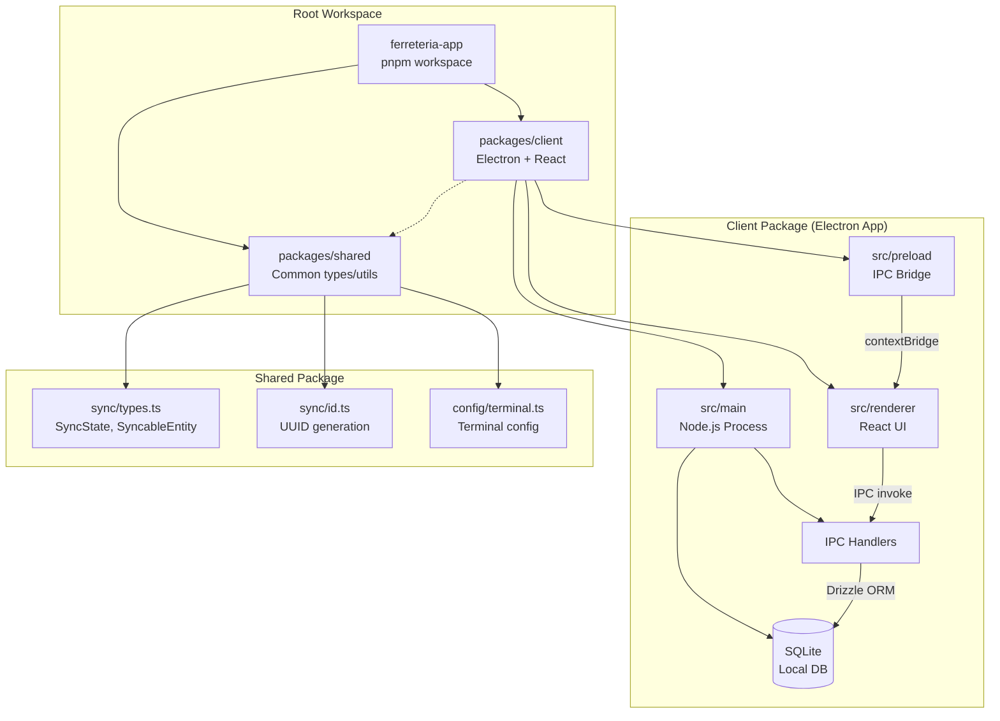
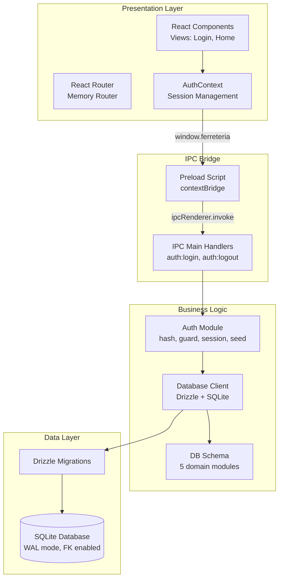
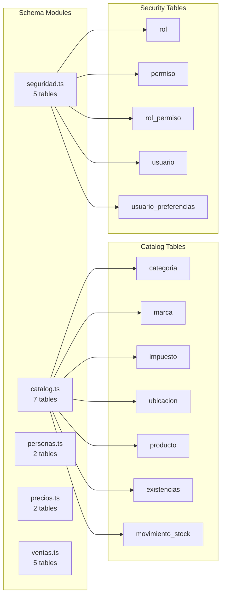
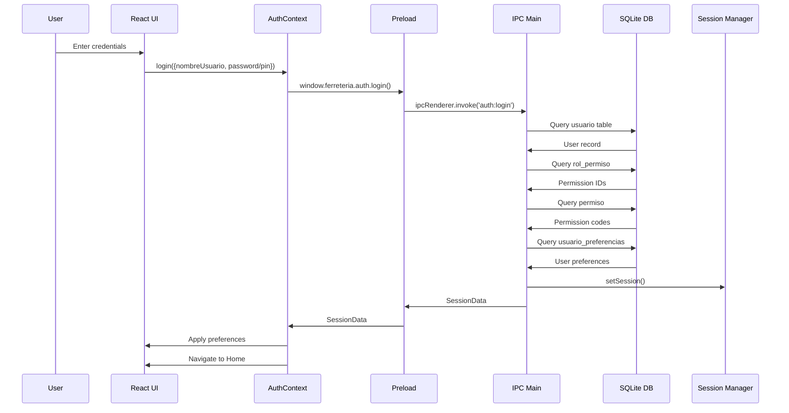
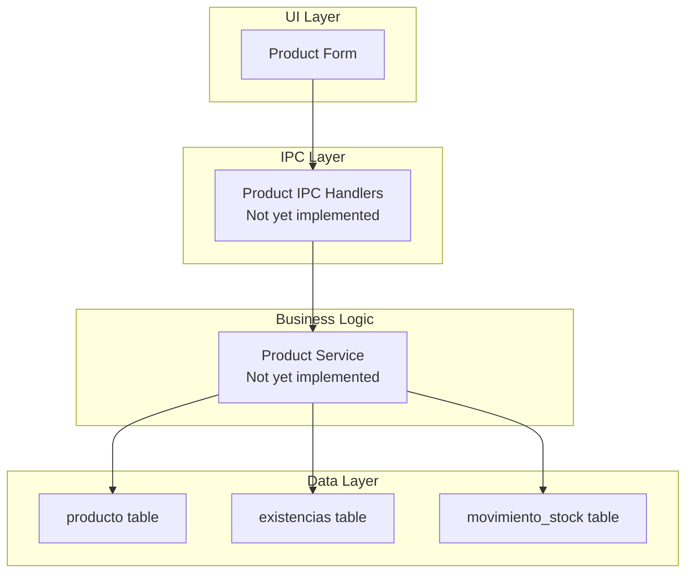
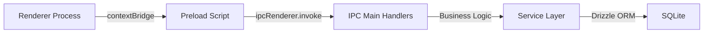
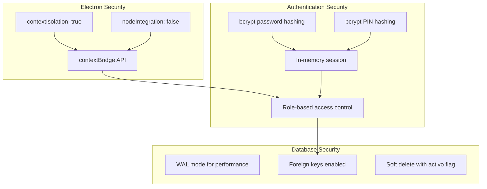

# Ferretería App - Architecture Diagram

## System Overview

This is an **offline-first** hardware store management system built with TypeScript, using a monorepo structure with pnpm workspaces.



## Architecture Layers



## Database Schema Structure



## Authentication Flow



## Data Flow: Product Management



## Key Design Patterns

### 1. Offline-First Architecture
- **SQLite** is the source of truth locally
- All writes go to SQLite first
- Future sync to cloud (PostgreSQL) via outbox pattern

### 2. IPC Communication Pattern


### 3. Sync Fields Pattern
Every syncable table includes:
- `version`: Integer version number
- `origin_id`: Terminal ID that created the record
- `sync_state`: enum('pending', 'synced', 'conflict')
- `updated_at`: Timestamp for conflict resolution

### 4. Immutable Ledger Pattern
Stock, cash, and account balances use:
- **Movement tables** (movimiento_stock, movimiento_caja, movimiento_cta_cte)
- **Running balance** (*_resultante field)
- Movements are never edited, only appended

## Technology Stack

| Layer | Technology |
|-------|-----------|
| **Build System** | pnpm workspaces, TypeScript |
| **Desktop App** | Electron 32.x |
| **UI Framework** | React 18.x, React Router 6.x |
| **Database** | SQLite (better-sqlite3), Drizzle ORM |
| **Testing** | Vitest, React Testing Library |
| **Packaging** | Electron Forge |

## Package Dependencies

```mermaid
graph TD
    Client[ferreteria-client] -->|workspace:*| Shared[@ferreteria/shared]
    Client --> Electron[electron]
    Client --> React[react, react-dom]
    Client --> Router[react-router-dom]
    Client --> SQLite[better-sqlite3]
    Client --> Drizzle[drizzle-orm, drizzle-kit]
    
    Shared[@ferreteria/shared] --> TS[typescript]
    Shared --> Vitest[vitest]
```

## Current Implementation Status

### ✅ Implemented (R1 - Bootstrap)
- Monorepo structure with pnpm workspaces
- Electron + React basic setup
- SQLite database with Drizzle ORM
- Authentication system (RBAC with 2 roles)
- User preferences (theme, accent, font, density)
- IPC bridge pattern
- Basic routing (Login, Home)
- Database schema for 5 domains (21 tables)

### 🚧 Planned (Future Releases)
- **R2**: Fiscal integration (AFIP/ARCA), invoicing
- **R3**: Purchases, credit accounts
- **R4**: Cloud sync (Node.js + PostgreSQL backend)
- **R5**: Consolidated reports, multi-branch preparation

## File Structure

```
ferreteria-app/
├── packages/
│   ├── client/                 # Electron + React app
│   │   ├── src/
│   │   │   ├── main/          # Node.js main process
│   │   │   │   ├── auth/      # Authentication logic
│   │   │   │   ├── db/        # Database & schema
│   │   │   │   ├── ipc/       # IPC handlers
│   │   │   │   └── config.ts
│   │   │   ├── preload/       # IPC bridge
│   │   │   └── renderer/      # React UI
│   │   │       ├── components/
│   │   │       ├── context/
│   │   │       ├── views/
│   │   │       └── routes/
│   │   ├── drizzle.config.ts
│   │   └── package.json
│   └── shared/                # Shared types & utilities
│       └── src/
│           ├── config/        # Terminal config
│           ├── sync/          # Sync types & ID generation
│           └── index.ts
├── docs/                      # Complete documentation
│   ├── TechSpec-ferreteria.md
│   ├── PRD-ferreteria.md
│   ├── Sistema-Diseno-ferreteria.md
│   └── ADR-Log-ferreteria.md
├── AGENTS.md                  # Project context for AI agents
├── CLAUDE.md                  # Permanent project context
├── package.json               # Root package.json
└── pnpm-workspace.yaml        # Workspace configuration
```

## Security Architecture



## Key Business Rules

1. **Offline-first**: All operations work without internet
2. **UUID generation**: All IDs generated on client
3. **Sync fields**: Every syncable table has version, origin_id, sync_state
4. **Immutable ledgers**: Stock/cash/account movements never edited
5. **RBAC**: Two roles (OPERADOR, SUPERVISOR) with permission codes
6. **Logical delete**: Soft delete with `activo` flag
7. **Audit trail**: All tables have creation/modification tracking
8. **Price calculation**: Base → % of list → line discount → global discount
9. **Rounding**: Total rounded to $1, difference in adjustment field
10. **Stock validation**: No sale without available stock
