# Manual de Usuario — Ferretería-app

**Versión del sistema documentada:** v1.0.x (R1+R3)
**Última actualización:** 2026-08-21
**Público:** cajero/vendedor · encargado de depósito · supervisor

> Este manual deriva del borrador en [`docs/Documentacion/Prompts/Manual-de-Usuario-Ferreteria.md`](../Prompts/Manual-de-Usuario-Ferreteria.md), con las capturas ya incorporadas. Las secciones marcadas `[PENDIENTE]` todavía no tienen paso a paso escrito — solo la captura de referencia.
>
> **Nota sobre versión:** el sistema agregó módulos nuevos desde que se escribió el borrador original (**Presupuestos, Remitos, Precios/Costos, Agenda** — ver `CLAUDE.md` ADR-044). Este documento cubre los capítulos originales (POS, Catálogo, Caja, Backup); los módulos nuevos quedan listados en el §12 a la espera de su propio capítulo.

---

## Índice

1. Introducción
2. Roles y qué puede hacer cada uno
3. Primeros pasos
4. Punto de venta (POS)
5. Catálogo de productos
6. Caja: apertura y cierre
7. Copias de seguridad
8. Facturación AFIP/ARCA *(R2)*
9. Compras, proveedores y cuenta corriente *(R3)*
10. Preguntas frecuentes
11. Glosario para el usuario
12. Módulos nuevos sin capítulo propio todavía

---

## 1. Introducción

Ferretería-app es el sistema de gestión de tu ferretería: registra las ventas, controla el stock y el catálogo de productos, maneja la caja y genera las copias de seguridad de tu información.

**Funciona sin internet.** Toda la información se guarda en la computadora del local, así que el sistema sigue vendiendo aunque se corte la conexión. La conexión solo hace falta para la facturación electrónica con AFIP/ARCA (módulo fiscal).

**Qué hace hoy:**

- Registrar ventas con distintos medios de pago, incluso combinados
- Administrar el catálogo de productos, categorías y marcas
- Imprimir etiquetas con código de barras y QR
- Abrir y cerrar la caja por turno
- Hacer y restaurar copias de seguridad
- Presupuestos, remitos, compras a proveedores y cuenta corriente de clientes (ver §12)

**Qué se agrega más adelante:** facturación electrónica AFIP/ARCA (R2) y sincronización entre varias terminales (R4).

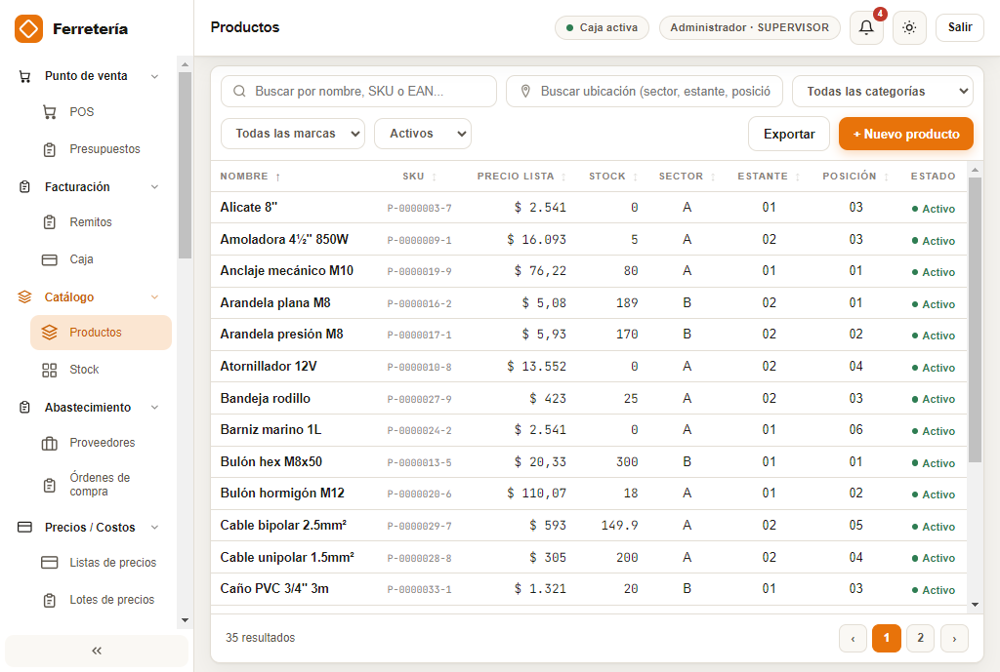

---

## 2. Roles y qué puede hacer cada uno

Cada persona entra con su **usuario y contraseña**. Según el rol, ve y puede hacer distintas cosas.

| Rol | Se ocupa de | Accede principalmente a |
|---|---|---|
| **Cajero / Vendedor (OPERADOR)** | Vender y manejar la caja de su turno | Punto de venta, Caja |
| **Encargado de depósito (OPERADOR)** | Cargar y mantener productos, stock y etiquetas | Catálogo, Stock, Etiquetas |
| **Supervisor** | Configuración, reportes, compras y clientes | Todo, incluida Configuración |

El menú de la izquierda (sidebar) está agrupado en secciones plegables. Vas a ver solo lo que tu rol permite.

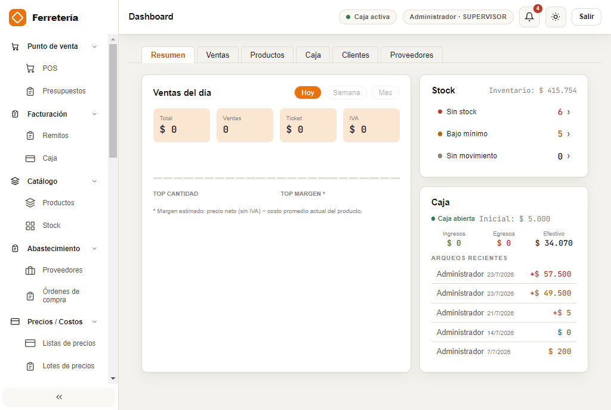

---

## 3. Primeros pasos

### 3.1 Instalar el sistema

El sistema se instala en Windows 10 con un instalador guiado (asistente "siguiente-siguiente"). Al terminar, queda un acceso directo en el escritorio.
*(El detalle técnico de instalación está en la Guía de Instalación y Operación — `[PENDIENTE]`.)*

### 3.2 Iniciar sesión

1. Abrí el sistema desde el acceso directo.
2. Ingresá tu **usuario** y **contraseña**.
3. Presioná **Ingresar**.

Si te olvidaste la contraseña, tiene que reiniciártela un supervisor desde Configuración → Usuarios.

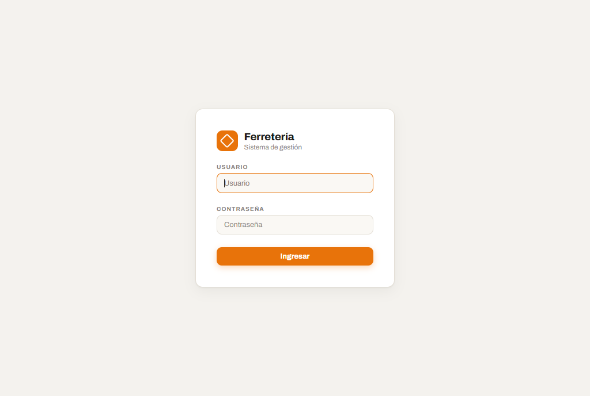

### 3.3 Conocer la pantalla

- **Sidebar (izquierda):** navegación por secciones.
- **Área central:** la pantalla en la que estás trabajando.
- **Encabezado:** estado de caja, usuario conectado, notificaciones y botón Salir.

> `[DIAGRAMA PENDIENTE: NAV-1 — mapa de navegación de pantallas]`

---

## 4. Punto de venta (POS)

> implementa: UC-POS-01 (Registrar venta), UC-POS-02 (Pago mixto), UC-POS-03 (Venta en espera)

La pantalla de venta tiene **tres zonas**: búsqueda/carga de productos, detalle de la venta en curso, y totales/acciones. **Nada se guarda hasta que confirmás la venta** en el modal final: podés armar y deshacer sin miedo.

### 4.1 Registrar una venta

1. Buscá el producto por nombre o escaneá su código QR/EAN.
2. Agregalo a la venta; repetí para cada ítem. Ajustá cantidades si hace falta.
3. Cuando esté completo, presioná **Confirmar**.
4. En el modal, elegí el **medio de pago** e indicá el monto.
5. Confirmá. Recién ahí la venta queda registrada y se descuenta el stock.

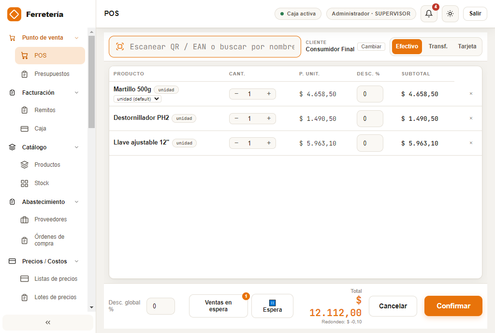

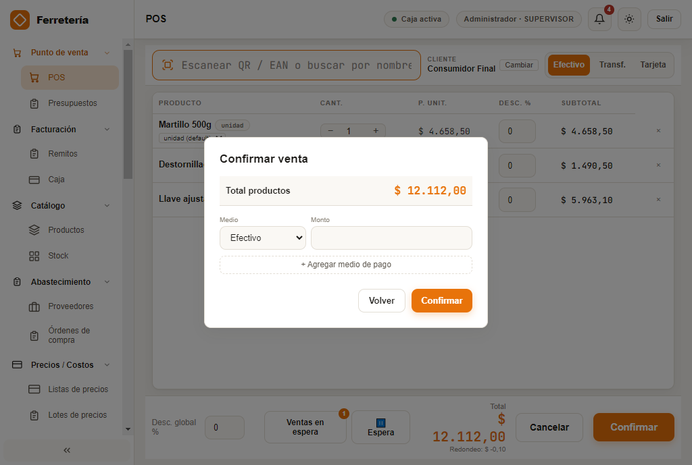

### 4.2 Pagos combinados (mixtos)

Podés cobrar una misma venta con **varios medios de pago** (por ejemplo, una parte en efectivo y otra con tarjeta).

1. En el modal de confirmación, agregá una línea de pago con **+ Agregar medio de pago**.
2. Indicá el monto de cada una hasta cubrir el total.
3. Si un medio tiene recargo, se muestra en su línea; **el total de la venta no cambia** por el recargo.
4. Si pagan en efectivo de más, el sistema calcula el **vuelto**.

> El redondeo a $1 se aplica únicamente sobre el total de la venta; las líneas conservan los centavos.

### 4.3 Dejar una venta en espera

Si un cliente deja la compra para más tarde:

1. Con la venta armada, elegí **Espera**.
2. Opcionalmente ponele un alias (ej. nombre del cliente o número de mesa).
3. La venta queda guardada como pendiente, sin afectar stock ni caja.
4. Cuando vuelve el cliente, la **retomás** desde el panel "Ventas en espera", o la **descartás** si no se concreta. Una venta en espera puede quedar marcada como **Vencida** si pasó mucho tiempo sin retomarse.

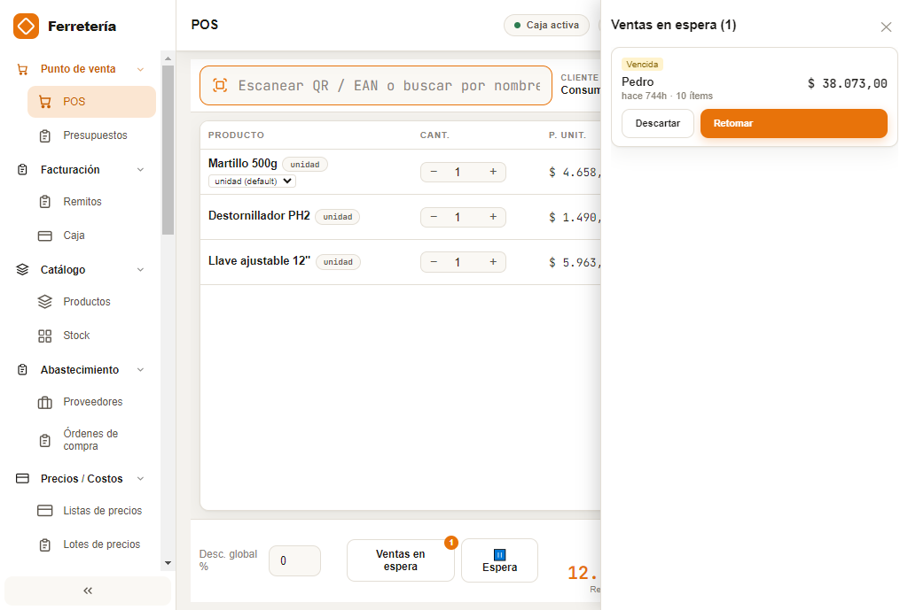

---

## 5. Catálogo de productos

> implementa: UC-CAT-01 (Alta de producto), UC-CAT-02 (Categorías y marcas), UC-CAT-03 (Etiquetas)

### 5.1 Dar de alta un producto

1. Desde Catálogo → Productos, presioná **+ Nuevo producto**.
2. Completá nombre corto (obligatorio), nombre largo y descripción técnica.
3. Elegí categoría (obligatoria) y marca.
4. Cargá precio de venta (IVA incluido), impuesto, unidad de venta y unidad de compra.
5. El sistema asigna un **SKU** automático correlativo (ej. `P-0000042-7`).

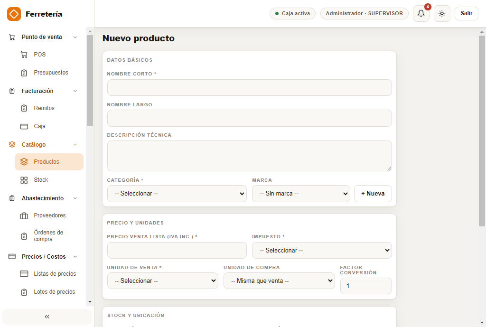

### 5.2 Categorías y marcas

`[PENDIENTE: paso a paso]` — ABM desde Configuración → Categorías / Marcas. No se puede desactivar una categoría o marca si tiene productos activos que la usan.

### 5.3 Imprimir etiquetas

1. Andá a Configuración → Etiquetas.
2. Elegí el formato de hoja (ej. A4 · 3×8) y el tipo de código (QR o código de barras).
3. Marcá los productos a imprimir con el checkbox de cada fila (podés filtrar por nombre, SKU, categoría o ubicación).
4. Usá **Vista previa** para revisar antes de imprimir, o **Exportar PDF** / **Imprimir** directamente.

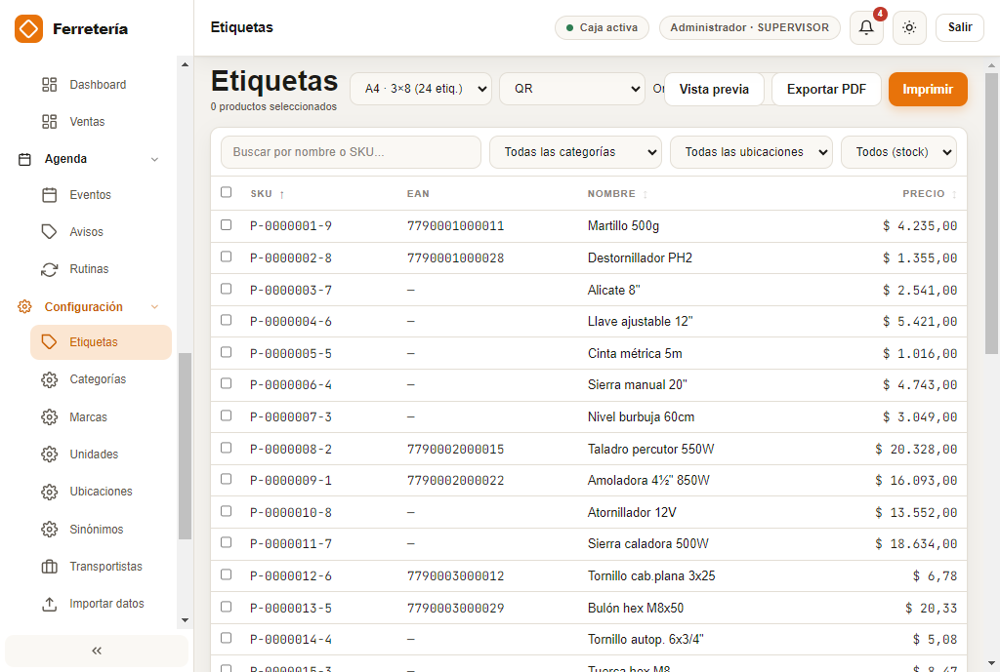

---

## 6. Caja: apertura y cierre

> implementa: UC-CAJA-01 (Apertura de turno), UC-CAJA-02 (Cierre de turno)

### 6.1 Apertura

Al abrir el turno se registra el **fondo de apertura** (efectivo inicial). Desde ese momento, la pantalla de Caja muestra en vivo el total de ventas, ingresos, egresos y el detalle de cada venta del turno.

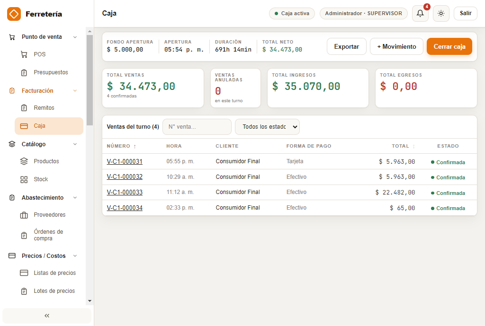

### 6.2 Cierre y arqueo

1. Presioná **Cerrar caja**.
2. El sistema muestra el resumen de ventas del turno y el desglose por medio de pago.
3. Contá el efectivo real en caja y cargalo en **Efectivo declarado**. El sistema calcula la diferencia contra el efectivo esperado.
4. Si la diferencia supera el umbral configurado, se necesita **autorización de un supervisor**.
5. Agregá observaciones si hace falta y confirmá el cierre.

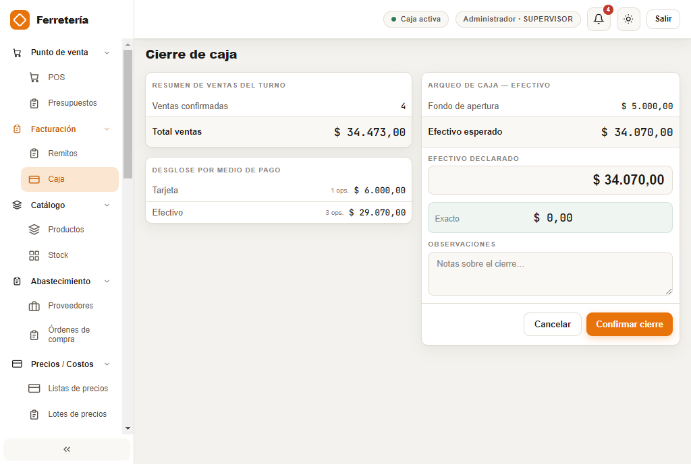

---

## 7. Copias de seguridad

> implementa: UC-BKP-01 (Crear backup), UC-BKP-02 (Restaurar)

El sistema genera copias de seguridad de toda tu información en un archivo `.fbk`, en Configuración → Sistema → Backup/Restore.

1. Elegí la carpeta destino (podés usar una carpeta sincronizada con Google Drive u OneDrive).
2. Activá **Backup automático al cerrar caja** si querés que se genere solo, sin acordarte.
3. Configurá los días de retención.
4. Usá **Crear backup ahora** para uno manual, o **Restaurar desde archivo...** para recuperar uno existente.

> Los certificados fiscales AFIP **no** se incluyen en la copia por seguridad, salvo que actives explícitamente esa opción.

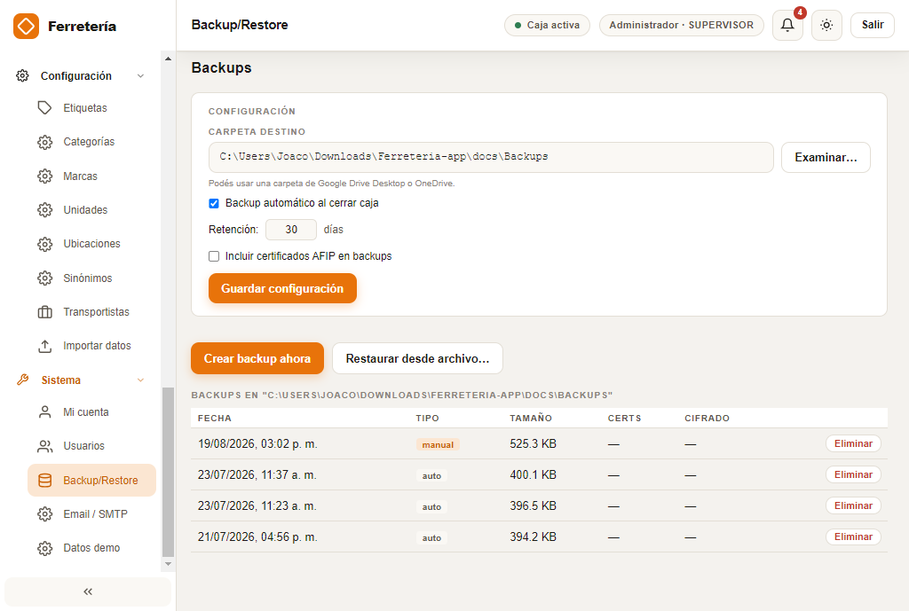

---

## 8. Facturación AFIP/ARCA *(R2 — en desarrollo)*

> implementa: UC-FISC-01 (Emitir comprobante), UC-FISC-02 (Nota de crédito)

`[PENDIENTE hasta cerrar el módulo]`. Cubrirá: configuración fiscal (CUIT, punto de venta, condición IVA), emisión de comprobante desde una venta, facturación manual vs. automática, y notas de crédito.

---

## 9. Compras, proveedores y cuenta corriente *(R3 — ya implementado, falta escribir el capítulo)*

> implementa: UC-COMP-*, UC-CLI-*

El sistema ya tiene operativos: alta de proveedores, órdenes de compra (manuales y sugeridas), recepción con costo real, cuenta corriente de clientes con límite de crédito, y remitos. Ver §12 para las capturas de referencia de cada pantalla — el paso a paso detallado queda `[PENDIENTE]`.

---

## 10. Preguntas frecuentes

- **¿Puedo vender sin internet?** Sí. Solo la facturación electrónica necesita conexión.
- **Me equivoqué armando una venta.** Mientras no confirmes en el modal, nada se guardó: sacá el ítem o cancelá la venta en curso.
- **¿Se puede borrar un producto?** No se elimina físicamente: queda inactivo. Así no se pierde el historial.
- **Olvidé mi contraseña.** Un supervisor te la reinicia desde Configuración → Usuarios.

---

## 11. Glosario para el usuario

> Subconjunto en lenguaje llano del glosario general (`docs/Documentacion/glosario.md` — `[PENDIENTE]`).

- **SKU:** código interno único de cada producto (ej. `P-0000042-7`).
- **Turno / Caja:** período de trabajo de un cajero, con su apertura y cierre.
- **Venta en espera:** compra guardada sin confirmar, que no afecta stock ni caja.
- **Comprobante:** factura o nota de crédito emitida ante AFIP/ARCA.
- **Backup (`.fbk`):** archivo con la copia de seguridad de toda tu información.
- **Remito:** comprobante de entrega de mercadería asociado a una venta, sin valor fiscal.
- **Presupuesto:** cotización para un cliente, sin compromiso de stock, que puede convertirse en venta.

---

## 12. Módulos nuevos sin capítulo propio todavía

Estos módulos ya están operativos en el sistema pero se agregaron después del borrador original del manual. Quedan documentados acá solo con su captura de referencia, a la espera de que se escriba el paso a paso de cada uno.

| Módulo | Qué es | Estado |
|---|---|---|
| Presupuestos | Cotizaciones para clientes, convertibles en venta | `[PENDIENTE: paso a paso]` |
| Remitos | Comprobante de entrega asociado a una venta | `[PENDIENTE: paso a paso]` |
| Precios / Costos | Listas de precios, lotes de recálculo masivo, importación de costos de proveedor | `[PENDIENTE: paso a paso]` |
| Agenda (Eventos, Avisos, Rutinas) | Recordatorios y tareas programadas (ej. conteo físico periódico) | `[PENDIENTE: paso a paso]` |
| Sinónimos de búsqueda | Grupos de términos equivalentes para mejorar la búsqueda de productos | `[PENDIENTE: paso a paso]` |
| Transportistas | Datos de fletes para remitos | `[PENDIENTE: paso a paso]` |
| Datos demo | Cargar/vaciar un catálogo de muestra para pruebas | `[PENDIENTE: paso a paso]` |

Las capturas de referencia de todas estas pantallas están en `assets/` bajo el nombre de cada módulo (ver también el inventario completo en [`docs/Documentacion/Tecnica/README.md`](../Tecnica/README.md) — `[PENDIENTE]`).
