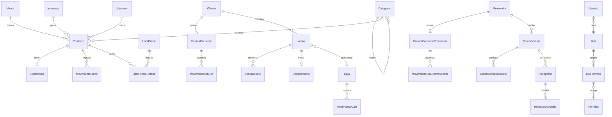

# Tech Spec — Software de Gestión de Ferretería

## 0. Control documental

| Campo | Valor |
|-------|-------|
| Documento | Especificación técnica (Tech Spec) |
| Producto | Sistema de gestión integral para ferretería |
| Versión | 2.0 (consolida las definiciones de las sesiones de trabajo) |
| Fecha | Junio 2026 |
| Documento base | PRD v2.0 · Acta de Definiciones v1.0 |
| Alcance | Diseño técnico, modelo de datos y detalle de procesos. No incluye código. |

> Detalla **cómo** se implementan los requisitos del PRD. Las decisiones abiertas se marcan `[ADR pendiente]`. La **Facturación electrónica (R2)** se especificará en una sesión posterior.

---

## 1. Arquitectura técnica

### 1.1 Componentes

| Componente | Tecnología | Responsabilidad |
|------------|-----------|-----------------|
| Cliente local | Electron + React + TypeScript | UI de operación, lógica offline. |
| Base local | SQLite | Fuente de verdad local. |
| Motor de sync (cliente) | TypeScript | Outbox + reconciliación con la nube. |
| Backend nube | Node.js + TypeScript | API de sync, consolidación, reportes (R4+). |
| Base nube | PostgreSQL | Consolidación, backup, base de reportes. |
| Integración fiscal | WSAA + WSFEv1 | Autenticación y CAE (R2). `[ADR: cliente o nube]` |
| Periféricos | Lector 1D/2D inalámbrico (HID), impresora común | Lectura de EAN/UPC y QR; impresión de comprobantes y etiquetas QR. |

### 1.2 Principios de diseño

- **Offline-first:** la operación nunca depende de la conexión. Escribe en SQLite y sincroniza asíncrono.
- **Idempotencia:** cada operación lleva identificador único; reaplicarla no duplica efectos.
- **Trazabilidad:** todo movimiento de stock, caja y cuenta corriente queda registrado.
- **Saldo + libro inmutable:** los saldos (stock, caja, cuentas corrientes) se respaldan en libros de movimientos que no se editan, solo se agregan.

### 1.3 Convenciones de sincronización

- Cada registro sincronizable lleva: `id` (UUID en cliente), `version`, `updated_at`, `origin_id` (terminal), `sync_state` (`pending` | `synced` | `conflict`).
- El cliente mantiene un **outbox** ordenado de operaciones pendientes.
- Resolución de conflictos: `[ADR pendiente: last-write-wins vs merge por campo]`.

---

## 2. Modelo de datos

> Patrones transversales (en todas las tablas salvo aclaración): `id` UUID en cliente; campos de sync (`version`, `origin_id`, `sync_state`); baja lógica `activo`; auditoría (`usuario_creacion_id`/`fecha_creacion`, y en editables `usuario_modificacion`/`fecha_actualizacion`); snapshots en líneas de venta/compra; `*_resultante` en los libros de movimientos.

### 2.1 Diagrama ER (relaciones principales)

### 2.2 Catálogo y stock

**Producto** (datos maestros): `id`, `sku` (autogenerado correlativo, editable), `codigo_qr` (único), `gtin_barcode` (nullable, **uno solo**), `nombre_corto`, `nombre_largo`, `descripcion_tecnica`, `unidad_venta` (stock/venta), `unidad_compra`, `factor_conversion` (unidad_venta por unidad_compra; default 1), `permite_fraccion`, `precio_costo_promedio`, `precio_venta_lista` (**IVA incluido**), `margen_ganancia` (calculado), `impuesto_id` (FK), `moneda`, `categoria_id` (FK única), `marca_id` (FK), `producto_padre_id` (FK nullable, variantes), `garantia_meses`, `ubicacion_id` (FK), `activo`, auditoría, sync. *Stock y límite de crédito NO viven acá. Diferidos: `slug`, `imagenes`, `peso_kg`, `dimensiones`.*

**Ubicacion** (catálogo): `id`, `codigo` (único, ej. `A-04-22`), `sector`, `estante`, `posicion` (**los tres obligatorios**), `descripcion` (opt), `activo`, auditoría, sync. Unicidad sobre `codigo` y sobre (`sector`,`estante`,`posicion`). Sin QR (no se escanea la ubicación).

**Existencias** (saldo por producto): `id`, `producto_id` (FK única), `stock_fisico` (DECIMAL), `stock_reservado` (nullable, futuro), `stock_en_transito` (nullable, futuro), `stock_disponible` (calculado), `stock_minimo`, `stock_maximo` (opt), `ultima_fecha_movimiento`, sync.

**MovimientoStock** (libro inmutable): `id`, `producto_id`, `tipo` (`entrada`/`salida`/`ajuste`/`transferencia`), `motivo` (`venta`/`recepcion_compra`/`devolucion`/`ajuste_conteo`/`merma_rotura`/`inicial`), `cantidad`, `stock_resultante`, `costo_unitario` (opt), `referencia_tipo`, `referencia_id`, `ubicacion_id` (opt), `usuario_id`, `fecha`, `observaciones`, sync.

**Categoria** (autorreferenciada, N niveles): `id`, `categoria_padre_id` (FK nullable; null = raíz), `nombre`, `descripcion`, `activo`, auditoría, sync.

**Marca**: `id`, `nombre` (único), `descripcion`, `activo`, auditoría, sync.

**Impuesto** (solo IVA): `id`, `nombre`, `tipo` (`iva`/`exento`/`no_gravado`), `alicuota`, `codigo_arca` (para R2), `predeterminado`, `activo`, auditoría, sync.

### 2.3 Personas

**Cliente**: `id`, `tipo_documento` (`DNI`/`CUIT`/`CUIL`), `numero_documento`, `razon_social`, `nombre_fantasia` (opt), `condicion_fiscal` (`RI`/`Monotributo`/`Consumidor Final`/`Exento`), domicilio/localidad/provincia/CP (opt), `telefono`/`email` (opt), `habilita_cuenta_corriente`, `lista_precio_id` (FK opt), `activo`, auditoría, sync. *Existe un cliente fijo "Consumidor Final" por defecto. `limite_credito` vive en CuentaCorriente.*

**Proveedor**: `id`, `tipo_documento`, `numero_documento`, `razon_social`, `nombre_fantasia` (opt), `condicion_fiscal`, domicilio (opt), `telefono`/`email` (opt), `persona_contacto` (opt), `observaciones` (opt), `activo`, auditoría, sync.

### 2.4 Ventas

**Venta** (cabecera): `id`, `numero_interno` (prefijo+terminal+correlativo, ej. `V-C1-000001`), `fecha`, `cliente_id` (FK), `usuario_id`, `caja_id`, `subtotal` (real, con centavos), `descuento_global`, `importe_iva`, `total` (redondeado), `ajuste_redondeo`, `forma_pago` (`efectivo`/`cuenta_corriente`/`transferencia`/`tarjeta`), `estado` (`borrador`/`confirmada`/`anulada`), `comprobante_id` (FK opt), `observaciones`, auditoría, sync.

**VentaDetalle** (líneas): `id`, `venta_id`, `producto_id`, `descripcion` (snapshot), `cantidad` (DECIMAL), `precio_unitario` (snapshot), `descuento_linea`, `alicuota_iva` (snapshot), `subtotal`, sync.

**Comprobante**: `id`, `venta_id` (FK opt), `tipo` (`ticket_interno`/`factura_a`/`factura_b`/`factura_c`/`nota_credito`/`nota_debito`), `punto_venta`, `numero`, `fecha_emision`, `cae`, `cae_vencimiento`, `condicion_fiscal_emisor`, `condicion_fiscal_receptor`, `importe_neto`, `importe_iva`, `importe_total`, `estado` (`pendiente_cae`/`autorizado`/`rechazado`/`anulado`), `comprobante_referencia_id` (FK, NC/ND), sync.

**Caja** (sesión): `id`, `usuario_id`, `fecha_apertura`, `fecha_cierre` (opt), `monto_inicial`, `monto_esperado` (opt), `monto_contado` (opt), `diferencia` (opt), `estado` (`abierta`/`cerrada`), `observaciones`, `usuario_cierre_id` (opt), sync.

**MovimientoCaja**: `id`, `caja_id`, `tipo` (`ingreso`/`egreso`), `motivo` (`venta`/`cobro_cta_cte`/`pago_proveedor`/`retiro`/`aporte`/`gasto`/`ajuste`), `monto`, `forma_pago` (opt), `referencia_tipo`, `referencia_id`, `usuario_id`, `fecha`, `observaciones`, sync. *Registra todos los medios de pago.*

### 2.5 Cuenta corriente de clientes

**CuentaCorriente**: `id`, `cliente_id` (FK única), `saldo` (positivo = el cliente debe), `limite_credito`, `fecha_ultimo_movimiento`, `activo`, sync.

**MovimientoCtaCte** (libro inmutable): `id`, `cuenta_id`, `tipo` (`cargo`/`pago`), `motivo` (`venta_credito`/`cobro`/`nota_credito`/`nota_debito`/`ajuste`/`saldo_inicial`), `monto`, `saldo_resultante`, `referencia_tipo`, `referencia_id`, `usuario_id`, `fecha`, `observaciones`, sync.

### 2.6 Compras (R3)

**OrdenCompra**: `id`, `numero_interno` (`OC-C1-000001`), `proveedor_id`, `fecha`, `fecha_entrega_estimada` (opt), `estado` (`borrador`/`emitida`/`recibida_parcial`/`recibida_total`/`anulada`), `subtotal`, `importe_iva`, `total`, `usuario_id`, `observaciones`, auditoría, sync.

**OrdenCompraDetalle**: `id`, `orden_compra_id`, `producto_id`, `descripcion` (snapshot), `cantidad_pedida`, `cantidad_recibida` (acumulado), `costo_unitario`, `alicuota_iva` (snapshot), `subtotal`, sync.

**Recepcion**: `id`, `orden_compra_id`, `fecha`, `usuario_id`, `remito_proveedor` (opt), `observaciones`, sync.

**RecepcionDetalle**: `id`, `recepcion_id`, `orden_compra_detalle_id`, `cantidad_recibida`, `costo_unitario_real` (opt), sync. *Soporta recepciones parciales.*

**CuentaCorrienteProveedor**: `id`, `proveedor_id` (FK única), `saldo` (positivo = le debés), `fecha_ultimo_movimiento`, `activo`, sync.

**MovimientoCtaCteProveedor** (libro inmutable): `id`, `cuenta_id`, `tipo` (`cargo`/`pago`), `motivo` (`recepcion`/`pago`/`ajuste`/`saldo_inicial`), `monto`, `saldo_resultante`, `referencia_tipo`, `referencia_id`, `usuario_id`, `fecha`, `observaciones`, sync.

### 2.7 Precios

**ListaPrecio**: `id`, `nombre` (único), `descripcion`, `tipo` (`general`/`especial`), `ajuste_porcentual` (**con signo**), `predeterminada`, `vigencia_desde`/`vigencia_hasta` (opt), `activo`, auditoría, sync.

**ListaPrecioDetalle** (excepción por producto): `id`, `lista_precio_id`, `producto_id`, `ajuste_porcentual` (**con signo, reemplaza al general para ese producto**), sync.

### 2.8 Seguridad

**Usuario**: `id`, `nombre_usuario` (único), `nombre_completo`, `hash_password`, `rol_id` (FK, **un rol por usuario**), `email` (opt), `pin_rapido` (hasheado), `activo`, `ultimo_acceso`, auditoría, sync.

**Rol**: `id`, `nombre` (único), `descripcion`, `es_sistema`, `activo`, sync. Roles base: **Operador**, **Supervisor**.

**Permiso**: `id`, `codigo` (único, ej. `venta.crear`), `descripcion`, `modulo`, sync.

**RolPermiso** (N:M): `id`, `rol_id`, `permiso_id`, sync.

**UsuarioPreferencias** (1:1 con Usuario): `id`, `usuario_id` (FK única), `tema`
(`claro`|`oscuro`), `acento` (`amber`|`blue`|`green`|`violet`|`brick`), `ui_font`
(`Hanken Grotesk`|`Figtree`|`Onest`), `densidad` (`comfortable`|`compact`), sync.
*Preferencias de apariencia por usuario (ver Sistema de Diseño §8); se cargan al iniciar
sesión. La fuente numérica no es configurable.*

---

## 3. Detalle de procesos

> Plantilla: objetivo · actor/rol · precondiciones · flujo principal · alternativos/errores · postcondiciones · datos afectados · offline/sync · release.

### 3.1 Alta de producto (R1)
- **Actor:** Operador, Supervisor (`producto.crear`). **Precondición:** existen Categoría, Impuesto y Ubicación.
- **Flujo:** 1) si trae código, escanea EAN/UPC → 2) valida duplicado (exacto por `gtin_barcode`; sin EAN, **advierte por nombre similar**) → 3) carga datos (nombre, categoría, marca, unidad, fracción, impuesto sugiere 21%, costo, precio) → 4) asigna ubicación del catálogo → 5) al guardar, **genera `codigo_qr` y SKU correlativo**, crea `Existencias` en 0 → 6) (opcional) imprime etiqueta **solo-QR** (chico 5×5 / mediano 10×10 / grande 15×15 cm).
- **Datos:** `Producto`, `Existencias`. **Offline:** local. **Release:** R1.

### 3.2 Entrada de stock (R1)
- **Actor:** Operador, Supervisor (`stock.entrada`).
- **Flujo:** busca producto (QR/EAN/nombre/SKU) → ingresa cantidad y costo opcional → genera `MovimientoStock` (`entrada`), incrementa `Existencias`, recalcula **costo promedio ponderado**.
- **Regla:** stock siempre vía movimiento (nunca stock sin justificación). **Release:** R1.

### 3.3 Recepción de compra (R3)
- **Actor:** Operador, Supervisor (`compra.recibir`). **Precondición:** OC `emitida`/`recibida_parcial`.
- **Flujo:** registra `Recepcion` (+remito) → por línea confirma cantidad y costo real → crea `RecepcionDetalle`, `MovimientoStock` (`entrada`/`recepcion_compra`), incrementa stock, **recalcula costo**, acumula `cantidad_recibida`, actualiza estado OC → genera **cargo en cuenta del proveedor** (= cantidad recibida × costo real).
- **Alternativos:** parcial (OC abierta por el resto); **sobre-recepción permitida con autorización del Supervisor**; producto sin ubicación → asignar antes de cerrar; si se recibe en `unidad_compra`, convertir a `unidad_venta` con `factor_conversion` (ADR-014). **Release:** R3.

### 3.4 Reglas de resolución de precio
- Cadena: **precio base** (`precio_venta_lista`) → **ajuste de lista** (% propio del producto si existe, si no % general) → **descuento de línea** → **descuento global**.
- **IVA incluido**; se discrimina en factura A. **Redondeo a $1 sobre el TOTAL** (diferencia en `ajuste_redondeo`; líneas conservan centavos).
- Descuentos: Operador sin tope ni autorización. **Sin override de precio** para Operador (solo Supervisor).

### 3.5 Venta en POS (R1 / R2 fiscal)
- **Actor:** Operador, Supervisor (`venta.crear`). **Precondición:** **caja abierta**.
- **Flujo:** 1) cliente por defecto **Consumidor Final** → 2) agrega líneas por QR/EAN/búsqueda, con **snapshots**; cantidades decimales en fraccionables → 3) resuelve precio (3.4) → 4) **si no hay stock disponible, no hay venta** → 5) descuento global, calcula IVA y total, **redondea a $1** → 6) forma de pago (cuenta corriente exige cliente habilitado; exceso de límite **advierte y bloquea salvo autorización del Supervisor**) → 7) confirma: `Venta`+`VentaDetalle`, `MovimientoStock` (`salida`/`venta`) → 8) cobro: `MovimientoCaja` (efectivo/tarjeta/transferencia) o `MovimientoCtaCte` (`cargo`/`venta_credito`) → 9) emite comprobante (ticket interno R1; fiscal R2) e imprime.
- **Alternativos:** código no hallado → búsqueda/alta rápida; productos **inactivos no se venden**; cancelación antes de confirmar → sin registros; **anulación** (3.5b).
- **Datos:** `Venta`, `VentaDetalle`, `Existencias`, `MovimientoStock`, `MovimientoCaja`/`MovimientoCtaCte`, `Comprobante`. **Offline:** todo offline salvo CAE (R2). **Release:** R1/R2.

### 3.5b Anulación de venta (R1)
- **Actor:** solo Supervisor (`venta.anular`).
- **Flujo:** selecciona venta `confirmada` → confirma con motivo → estado `anulada` → **movimientos inversos** (no se borra nada): stock `entrada`/`devolucion`; caja egreso o cuenta corriente contra-cargo; fiscal vía **nota de crédito** (R2).
- **Regla:** se permite anular ventas de **cajas cerradas / días anteriores**; el inverso impacta en la **caja actual** y queda registrado el desfasaje. Requiere caja abierta para la reversión de efectivo.

### 3.6 Apertura y cierre de caja (R1)
- **Apertura** (`caja.operar`): ingresa monto inicial; impide abrir si ya tiene una abierta.
- **Cierre:** calcula esperado **por forma de pago**; cuenta el **efectivo**; tarjeta/transferencia se concilian contra comprobantes; **diferencia solo sobre efectivo**; diferencia > **umbral parametrizable** requiere **autorización del Supervisor**; cierra con arqueo y reporte Z.
- El **Operador puede registrar retiros y gastos** (auditados). **Release:** R1.

### 3.7 Cobro de cuenta corriente (R3)
- **Actor:** Operador, Supervisor (`ctacte.cobrar`). **Precondición:** caja abierta.
- **Flujo:** busca cliente y saldo → ingresa monto y forma de pago → `MovimientoCtaCte` (`pago`/`cobro`) + `MovimientoCaja` (ingreso/`cobro_cta_cte`).
- **Regla:** **sobrepago permitido** (saldo a favor); **todo cobro pasa por caja**. **Release:** R3.

### 3.8 Pago a proveedor (R3)
- **Actor:** **solo Supervisor** (`proveedor.pagar`). **Precondición:** caja abierta.
- **Flujo:** busca proveedor y saldo → ingresa monto y forma de pago → `MovimientoCtaCteProveedor` (`pago`) + `MovimientoCaja` (egreso/`pago_proveedor`).
- **Regla:** sobrepago permitido; todo pago pasa por caja. **Release:** R3.

### 3.9 Localización de producto (R1)
- **Actor:** Operador, Supervisor (`producto.consultar`). **Consulta, 100% offline.**
- **Por producto:** escanea QR (o busca) → muestra ubicación (`sector/estante/posicion`+`codigo`) y stock.
- **Por ubicación (inversa, R1):** elige ubicación → lista productos asignados con stock.
- **Reubicar:** edición normal (`ubicacion_id`), **sin reimprimir**. **Release:** R1.

### 3.10 Importación masiva (Excel/CSV) (R1)
- **Actor:** **solo Supervisor**, auditada. Entidades: Producto, Cliente, Proveedor, Ubicacion, stock inicial, Lista de precios.
- **Flujo:** descarga plantilla → completa → sube → **validación fila por fila** (tipos, obligatorios, duplicados, referencias) → **previsualización** (OK / error con motivo / actualización) → confirma → **resumen descargable**.
- **Reglas:** **crear + actualizar** (match por SKU/EAN o documento); importa las válidas aunque otras fallen; productos autogeneran QR y SKU y nacen con `Existencias` 0; **stock inicial entra por su propia importación** generando `MovimientoStock`. **Release:** R1.

### 3.11 Dashboard local (R1)
- **Actor:** solo Supervisor. Local (datos de la terminal).
- **Áreas R1:** Ventas (del día, ticket promedio, más vendidos, por forma de pago), Stock (bajo mínimo, valor de inventario a costo, sin movimiento), Caja (ingresos vs. egresos, estado de caja, diferencias de arqueo).
- Compras y Cuentas Corrientes → R3; consolidado multi-terminal → R4/R5. **Datos:** solo lectura. **Release:** R1.

### 3.12 Sincronización offline-first (R4)
- **Subida:** el motor toma operaciones `pending` del outbox en orden → las envía con `id`/`version`/`origin_id` → el backend aplica **idempotente** y confirma → marca `synced`.
- **Bajada:** el backend devuelve cambios desde el último `updated_at`; el cliente los aplica.
- **Conflicto:** se marca `conflict` y se resuelve según `[ADR pendiente]`; log revisable por Supervisor. **Release:** R4.

---

## 4. Transversales

### 4.1 Numeración
- **Interna** (`numero_interno`): sistema, desde R1; **prefijo + terminal + correlativo** (`V-C1-000001`, `OC-C1-000001`); se asigna al confirmar; visible en el ticket.
- **Fiscal** (`punto_venta`+`numero`): ARCA, correlativa por (tipo + punto de venta); se obtiene **al solicitar el CAE** (R2); en `pendiente_cae` aún no tiene número fiscal.

### 4.2 Reposición sugerida (R1)
- Informativa. Dispara con `stock_disponible <= stock_minimo` (**un solo umbral**). Cantidad sugerida = `stock_maximo - stock_disponible` (en `unidad_venta`; puede mostrarse también convertida a `unidad_compra`/cajas vía `factor_conversion`). Alerta + reporte (Supervisor).

---

## 5. Matriz RBAC (resumen)

Leyenda: ✔ permitido · ✱ con condición/autorización · — no permitido.

| Caso de uso | Operador | Supervisor |
|-------------|:--------:|:----------:|
| Operar POS / vender | ✔ | ✔ |
| Abrir/cerrar caja | ✔ (la suya) | ✔ (cualquiera) |
| Cerrar caja con diferencia > umbral | ✱ (autoriza Supervisor) | ✔ |
| Retiros / gastos de caja | ✔ | ✔ |
| Alta/edición de producto, ubicaciones, etiquetas QR | ✔ | ✔ |
| Entrada/ajuste de stock | ✔ | ✔ |
| Localización de producto | ✔ | ✔ |
| Recepción de compra | ✔ | ✔ |
| Sobre-recepción (más que lo pedido) | ✱ (autoriza Supervisor) | ✔ |
| Venta a cuenta corriente sobre el límite | ✱ (autoriza Supervisor) | ✔ |
| Cobro de cuenta corriente (cliente) | ✔ | ✔ |
| Pago a proveedor | — | ✔ |
| Override de precio en venta | — | ✔ |
| Anulación de venta | — | ✔ |
| Gestión de proveedores / OC | — | ✔ |
| Configuración fiscal, precios, listas | — | ✔ |
| Importación masiva | — | ✔ |
| Dashboard / reportes | — | ✔ |
| Administración de usuarios | — | ✔ |

> Permisos por `codigo` (`venta.crear`, `stock.ajustar`, etc.); seed inicial en R1.

---

## 6. Manejo de errores y casos límite (transversal)

- **Pérdida de conexión:** ninguna operación de venta/stock/caja se bloquea; solo el CAE fiscal (R2) depende de conexión.
- **Reintentos:** operaciones fiscales y de sync reintentan automáticamente con backoff.
- **Idempotencia:** toda operación enviada a la nube o a ARCA lleva identificador único.
- **Auditoría:** ajustes manuales y autorizaciones quedan registrados con usuario y fecha.
- **Numeración fiscal:** correlatividad validada contra el último número autorizado por ARCA antes de emitir.

---

## 7. Seguridad

- Contraseñas y `pin_rapido` con hash (algoritmo en arquitectura).
- Autorización verificada en cada caso de uso contra la matriz RBAC.
- Token de sesión con expiración.
- Certificados AFIP/ARCA resguardados según recomendación de ARCA.
- Comunicación cliente–nube sobre HTTPS.

---

## 8. Trazabilidad módulo → proceso → release

| Módulo (PRD) | Proceso(s) | Release |
|--------------|-----------|---------|
| Catálogo | 3.1 | R1 |
| Inventario / stock | 3.2, 3.8(stock) | R1 |
| Ubicaciones / localización | 3.1, 3.9 | R1 |
| POS | 3.4, 3.5, 3.5b | R1 (R2 fiscal) |
| Caja | 3.6 | R1 |
| Importación masiva | 3.10 | R1 |
| Reposición sugerida | 4.2 | R1 |
| Dashboard local | 3.11 | R1 |
| Facturación electrónica | (a especificar) | R2 |
| Compras | 3.3 | R3 |
| Cuenta corriente clientes | 3.7 | R3 |
| Cuenta corriente proveedores | 3.8 | R3 |
| Sincronización | 3.12 | R4 |
| RBAC | §5 | R1 |

---

## 9. Decisiones abiertas (ADR pendientes)

1. **ADR-013** Ubicación de la integración fiscal (cliente vs nube) — R2.
2. **Facturación electrónica R2** (proceso completo) — a especificar en sesión posterior.

> Cerradas: ADR-012 (last-write-wins + log), ADR-014 (unidades venta/compra + factor),
> ADR-015 (impresión etiquetadora y A4, configurable), ADR-016 (Drizzle + pnpm).
